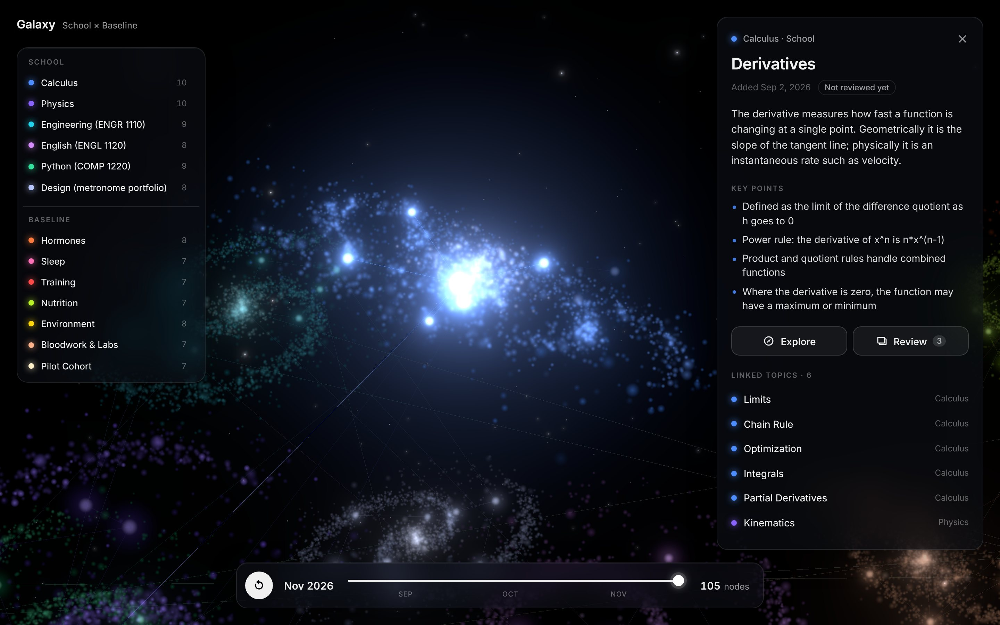
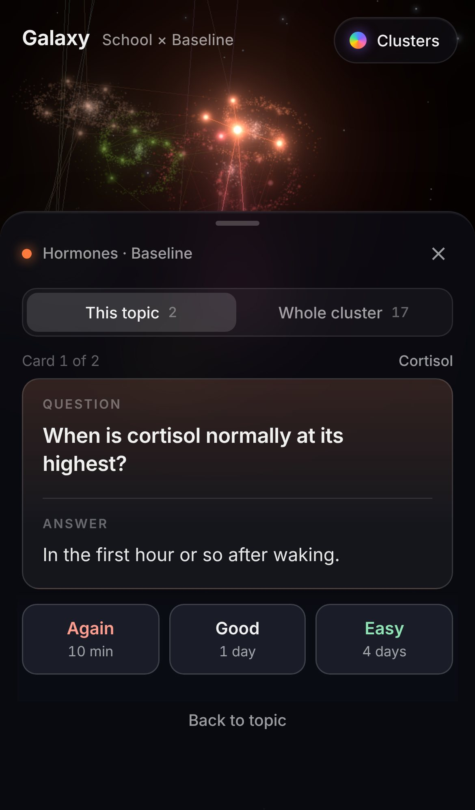

# Galaxy

School topics and the Baseline app, drawn as a glowing 3D galaxy that grows over time.
Static site: Vite + TypeScript + Three.js. No backend, no tracking, no network calls after the page loads.

| Desktop | Phone |
| --- | --- |
|  |  |
|  |  |

> **The notes and flashcards in `public/galaxy.json` are placeholder text.** Every `overview`, `points` and `cards`
> entry was written as filler so the detail panel, the Explore tour and Review have something to show. They are
> plausible, but they have not been checked against a textbook, a syllabus or any source, and the Baseline ones are
> not medical advice. Replace them with your own notes before relying on them.

## Run it

Needs Node 20 or newer.

```bash
cd galaxy
```

```bash
npm install
```

```bash
npm run dev
```

Then open the address Vite prints (usually http://localhost:5173).

| Command | What it does |
| --- | --- |
| `npm run dev` | Local server with live reload |
| `npm test` | Unit tests (vitest) |
| `npm run build` | Type-check in strict mode, then build the static site into `dist/` |
| `npm run preview` | Serve the built `dist/` locally |

## Using it

- **Drag** to orbit, **scroll or pinch** to zoom, **right-drag or two-finger drag** to pan.
- It rotates slowly when left alone and stops the moment you touch it. It starts again after 5 seconds.
- **Hover** a node to see its label, cluster and date.
- **Click** (or **tap**) a node to open it. See "Node detail mode" below.
- **Click a cluster** in the legend to fly to it. Click it again, or "Show whole galaxy", to fly back. On a phone the legend is behind the **Clusters** button.
- **Timeline** at the bottom: play/pause (or the space bar), drag the scrubber, and watch nodes appear by date.

### Node detail mode

Clicking a node flies the camera to it, lights up its links, keeps its neighbours bright and dims everything else.
A panel slides in from the right (from the bottom on a phone) with the title, cluster and group, the date it was
added, an overview, key points, and the list of linked nodes. Click any linked node to jump to it.

- **Explore** walks a route from this node along its links, up to 8 stops, with **Back** and **Next** (or the arrow
  keys). The camera flies along each link behind a trail of particles. The route never repeats a node, prefers the
  longest path, and moves forward in time when it has a choice.
- **Review** shows the node's flashcards one at a time: read the question, tap to reveal, then pick **Again**,
  **Good** or **Easy** (or press 1, 2, 3). A switch at the top changes between this topic and its whole cluster.
  Nodes without cards have no Review button.
- **Esc** or the close button returns to the whole galaxy. Inside a review, Esc first goes back to the topic.
- **Keyboard:** when a node opens, focus moves into the panel. Tab moves through the buttons and the linked
  nodes, Enter opens the one in focus.

**The review schedule** is kept per node and is deliberately simple:

| Grade | First time | After that |
| --- | --- | --- |
| Again | back in 10 minutes | back in 10 minutes, and the next gap starts over at 1 day |
| Good | 1 day | about 2.5 times the last gap: 1, 3, 8, 20, 50 days |
| Easy | 4 days | grows faster still, and later gaps grow a little faster too |

A node with several cards gets the grade of its weakest card. A node that is due shows a slow ring in the galaxy and
is counted next to its cluster in the legend. Nodes you have never reviewed are "new", not "due", so the galaxy
doesn't start out covered in rings.

Progress is saved in this browser's `localStorage` under `galaxy.review.v1` and nowhere else. It is not synced
between devices, and clearing site data resets it. If the browser blocks storage, review still works for the
session; it just isn't remembered.

Add `?debug` to the address for an FPS readout (frame rate, frame time, particles drawn, quality level).
Add `?lockquality` to stop the automatic quality drop, for benchmarking.

## Edit the data

Everything on screen comes from one file: [`public/galaxy.json`](public/galaxy.json). Edit it, save, reload.

```json
{
  "clusters": [
    { "id": "calc", "name": "Calculus", "color": "#4d8dff", "group": "School" }
  ],
  "nodes": [
    { "id": "calc-limits", "label": "Limits", "cluster": "calc", "date": "2026-08-19" },
    {
      "id": "calc-derivatives", "label": "Derivatives", "cluster": "calc", "date": "2026-09-02", "size": 4,
      "overview": "The derivative measures how fast a function is changing at a single point.",
      "points": [
        "Power rule: the derivative of x^n is n*x^(n-1)",
        "Where the derivative is zero, the function may have a maximum or minimum"
      ],
      "cards": [
        { "q": "What is the derivative of x^n?", "a": "n * x^(n-1), the power rule." }
      ]
    }
  ],
  "links": [
    ["calc-limits", "calc-derivatives"]
  ]
}
```

**Clusters**

| Field | Required | Meaning |
| --- | --- | --- |
| `id` | yes | Short unique name that nodes refer to |
| `name` | yes | What the legend shows |
| `color` | yes | Hex color, `#rgb` or `#rrggbb` |
| `group` | no | Which super-cluster it belongs to (`"School"`, `"Baseline"`). Clusters with the same group sit together. Groups appear in the order they are first used. |

**Nodes**

| Field | Required | Meaning |
| --- | --- | --- |
| `id` | yes | Unique name that links refer to |
| `label` | yes | Shown on hover or tap |
| `cluster` | yes | The `id` of one of the clusters |
| `date` | yes | `YYYY-MM-DD`. The node appears when the timeline reaches this date. |
| `size` | no | 1 to 5. Leave it out and the size comes from the link count: 1, plus 0.5 per link, up to 5. |
| `overview` | no | A paragraph shown at the top of the node's detail panel |
| `points` | no | A list of short texts, shown as "Key points" |
| `cards` | no | A list of flashcards, each exactly `{ "q": "question", "a": "answer" }`. Leave it out (or empty) and the node has no Review button. |

**Links** are pairs of node ids. Order does not matter, and the same pair written twice counts once.
A link shows up once both of its nodes are on screen.

The timeline runs from the earliest node date to the latest.
Each cluster gets 1,000 to 4,000 particles, a few more for clusters with more nodes.

### If you break the file

The page checks the file on load and shows an error card instead of the galaxy. It tells you where to look:

- JSON mistakes (missing or trailing comma, unclosed bracket, single quotes, comments) give a **line and column**.
- Data mistakes give the **line and the field**, for example `Line 90 · nodes[63].cluster · Unknown cluster "sleeep". Did you mean "sleep"?`

Things it checks: required fields, duplicate ids, nodes pointing at a cluster that doesn't exist, links pointing at a
node that doesn't exist, dates that aren't real calendar dates, sizes outside 1 to 5, colors that aren't hex, and
misspelled field names. The optional fields are checked just as strictly when they are present: `overview` has to
be non-empty text, every item in `points` has to be non-empty text, and every card needs both `q` and `a` and
nothing else.

## Deploy to Vercel

The site is plain static files, so there is nothing to configure beyond telling Vercel where it lives.

**From the dashboard**

1. Import the repository at vercel.com/new.
2. Set **Root Directory** to `galaxy`.
3. Deploy. `vercel.json` already sets the build command (`npm run build`) and the output folder (`dist`).

**From the terminal**

```bash
cd galaxy
```

```bash
npx vercel --prod
```

Any other static host works too: run `npm run build` and upload the `dist/` folder. All paths are relative, so it can
sit at a domain root or in a sub-folder.

To update the live galaxy, edit `public/galaxy.json`, commit, and push. Vercel rebuilds on its own.

## How it works

| Part | File | Notes |
| --- | --- | --- |
| Load and validate | `src/data/` | Small JSON parser that tracks line numbers, then field checks. Never throws. |
| Sizes and timeline | `src/data/sizing.ts`, `src/data/timeline.ts` | Pure functions, unit tested |
| Layout | `src/layout/layout.ts` | d3-force-3d, seeded and run to rest before the first frame, so nothing moves on load |
| Rendering | `src/render/` | Three.js with `UnrealBloomPass`. Nodes, links, particles and stars are four draw calls. |
| Particles | `src/render/particles.ts` | One `THREE.Points` with a custom vertex shader. The swirl runs on the GPU; JavaScript only advances a clock. |
| Fading by date | `src/render/fade.ts` | One small texture holds each node's visibility. Nodes, links and particles all read it, so they always agree. |
| Focus and dimming | `src/render/fade.ts`, `src/render/renderer.ts` | The same texture carries each node's brightness and its "due" flag, so dimming costs no extra draw calls |
| Explore route | `src/explore/path.ts` | Pure function: longest walk along links without repeats, capped at 8 stops |
| Explore trail | `src/render/trail.ts` | 320 particles in one draw call, moved in the vertex shader |
| Review | `src/review/` | Scheduler, flashcard session and the `localStorage` wrapper, all unit tested |
| Detail mode | `src/detail/detailMode.ts` | Ties focus, Explore and Review together and drives the panel |
| UI | `src/ui/` | Legend, timeline bar, detail panel, tooltip, error card, FPS readout |

**Performance and motion**

- Frame rate is measured in one-second windows. Two slow windows in a row (under 30 FPS) step quality down: fewer
  particles first, then a lower pixel ratio. There are five levels and it never steps back up, so it can't flicker.
- Pixel ratio is capped at 2 and at about 7 million pixels per frame.
- Rendering stops completely while the tab is hidden.
- With "reduce motion" switched on in the system settings there is no auto-rotate, no swirl, no drift and no
  autoplay; bloom is constant; camera moves cut instead of flying; the Explore trail is off; the "due" ring is a
  still circle instead of a pulse; and frames are only drawn when something changes.

## Tests

```bash
npm test
```

- `tests/validate.test.ts`: JSON validation, line numbers, the seed file itself
- `tests/sizing.test.ts`: link-count sizing
- `tests/timeline.test.ts`: filtering nodes by date, month labels, the node count
- `tests/layout.test.ts`: the layout is deterministic and keeps the two super-clusters apart
- `tests/boot.test.ts`: a broken, missing or empty `galaxy.json` shows the error card instead of crashing
- `tests/detailFields.test.ts`: validation of `overview`, `points` and `cards`, with line numbers
- `tests/scheduler.test.ts`: the review schedule, the flashcard session, and saving to storage that may be blocked
- `tests/explore.test.ts`: the Explore route (linked steps only, no repeats, respects the timeline)
