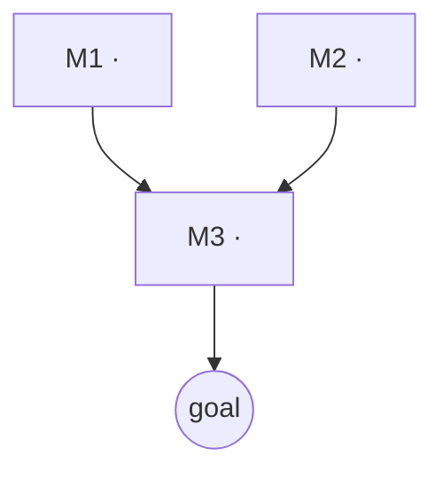

# Curriculum

The `teach` skill runs one lesson: probe → plan → teach. A big topic is the same idea one level up: a **dependency graph of modules**, each module a lesson-sized subgraph. Claude Code sessions don't remember each other, so the graph and what the learner holds live **on disk** and every session starts by reading them.

## Files

```
topics/<slug>/
  roadmap.md     the goal, scope, module DAG, and per-module status
  learner.md     what the learner reliably holds, where edges sit, misconceptions, preferences
  sessions/      one md-log file per session (YYYY-MM-DD-<module-id>.md)
viz/             published diagrams (shared across topics)
```

Keep `topics/` inside the Obsidian vault so roadmaps, logs and diagrams all render together.

### roadmap.md shape

````markdown
# <Topic>

**Goal:** <the concrete outcome from Phase 1b — what they'll be able to do/explain>
**Out of scope:** <what we deliberately skip>
**Started:** YYYY-MM-DD

## Map



## Modules

| id | module | rests on | unconditional truths / core idea | status | last | next review |
|----|--------|----------|----------------------------------|--------|------|-------------|
| M1 | … | — | … | solid | 2026-10-19 | 2026-10-22 |
| M2 | … | — | … | not started | | |
| M3 | … | M1, M2 | … | not started | | |
````

Status values: `not started` → `in progress` → `solid` (quiz-checked at the end of its session) → `shaky` (missed in review; re-teach before building on it).

### learner.md shape

```markdown
# Learner model — <Topic>

## Holds reliably
- <claim> (confirmed YYYY-MM-DD, M2)

## Edges found
- <strand>: floor = <what they got right>, ceiling = <what broke>

## Misconceptions (dislodge, don't top up)
- <wrong model> — seen YYYY-MM-DD, status: open | fixed

## Preferences
- Socratic vs expository, pace, energy notes, what clicked
```

## Mode: plan  (`/learn:plan <topic>`)

1. **Goal first (ungraded AskUserQuestion).** Big topics are the vaguest goals. Interrogate until the goal is concrete and testable: *"After this, I can ___."* Also ask about time budget (sessions/week) and depth.
2. **Scope the field with the `researcher` subagent** — ask it to *scope a field*: first principles, the standard dependency order of concepts, common misconceptions. For a huge field, run 2–3 researchers in parallel on different sub-areas.
3. **Breadth probe (quizzes).** One fast sweep across the big strands (batch up to 4 per AskUserQuestion), to find which top-level modules the learner already holds. Don't map every edge yet — each session will probe its own module deeply.
4. **Build the module DAG.** Rules:
   - Each module is **one sitting** (≈ 30–90 min): one cluster of nodes with a single clear payoff.
   - Roots are modules made of **unconditional truths** for this learner. Stress-test every root: is it really foundational for them, or a disguised theorem? Push it down if it derives.
   - Every edge means "can't be understood without". No decorative edges.
   - The goal is the sink. Prefer 5–15 modules; group into phases if bigger.
   - Mark modules the breadth probe showed they already hold as `solid` (they'll still get a light check when first relied on).
5. **Present the roadmap** — approach in prose, then the mermaid map (use the `visualize` skill for a verified PNG if it's big). **Stop and get their go-ahead.** Adjust until they agree.
6. **Write** `topics/<slug>/roadmap.md` and `topics/<slug>/learner.md`. Tell them: run `/learn:session <slug>` to start.

## Mode: session  (`/learn:session [slug] [module]`)

1. **Load state.** If no slug, list `topics/*/roadmap.md` and pick the most recently touched (ask if ambiguous). Read `roadmap.md` and `learner.md` fully.
2. **Due reviews first.** If any `solid` module's `next review` date is today or earlier, run a short review (mode below, 2–4 questions) before new material — especially for modules the next one rests on.
3. **Pick the module:** the requested one, else the first `in progress`, else the first `not started` whose prerequisites are all `solid`. If a prerequisite is `shaky`, re-teach that first. Tell the learner which module and why in one line.
4. **Start the log** with Bash: `node "${CLAUDE_SKILL_DIR}/../../scripts/md-log.mjs" link topics/<slug>/sessions/<YYYY-MM-DD>-<module-id>.md` (if the path didn't expand, find `scripts/md-log.mjs` under `~/.claude/plugins`). Mention the file so the learner can open it in Obsidian.
5. **Teach it with the `teach` skill** — the full probe → plan → teach, scoped to this module. Use `learner.md` to shorten the probe, but re-probe the strands this module rests on. The lesson plan's dependency map is the module's internal subgraph.
6. **Close-out (always, even if the session ends early):**
   - Final quiz-check of the module's key nodes.
   - Update `roadmap.md`: status (`solid` only if the final check passed; else `in progress`), `last` = today, `next review` = today + 3 days for a newly solid module.
   - Update `learner.md`: new reliable holdings, edges found, misconceptions (open/fixed), preference notes.
   - If the session revealed the DAG is wrong (a missing prerequisite, a module too big), edit the map and tell the learner what changed.
   - Tell them the next ready module.

## Mode: review  (`/learn:review [slug]`)

Spaced retrieval keeps `solid` honest.

1. Collect `solid` modules whose `next review` is due (if none are due, offer the oldest few).
2. Per module, 1–3 quizzes that require **deriving** from its unconditional truths, not recalling the wording — understanding should survive rephrasing.
3. Update the schedule: pass → next interval roughly doubles (3 → 7 → 14 → 30 days); miss → mark `shaky`, reset to 3 days, note the misconception in `learner.md`, and offer a short re-teach right now (via `teach`, starting from the root that failed).
4. Report: what's holding, what faded, what to do next.

## Principles carried over from `teach`

- Accuracy is non-negotiable: verify with `researcher` before teaching anything you're unsure of — including the roadmap's claims about what depends on what.
- Every module must be **motivated** in the roadmap: why does the goal need it?
- Small and solid beats large and shaky — at the curriculum level too. Cut modules the goal doesn't need.
